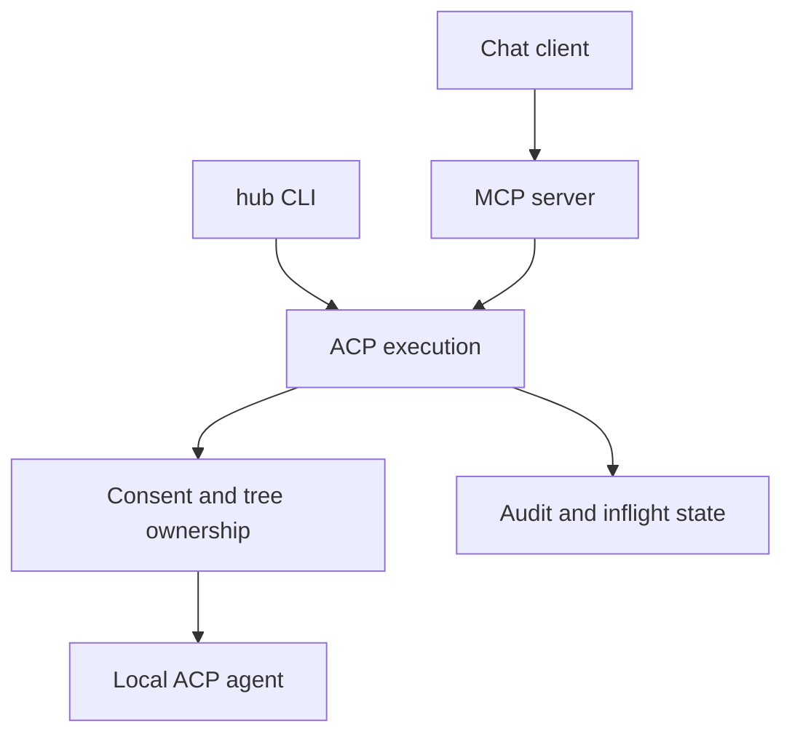

# Architecture

AgenticHub governs delegation between a chat client and local coding agents. It
chooses who works, in which tree, with which grant, and records each attempt.
It is a backend; OpenCode and Claude Code provide the daily chat surfaces.

## Components

| Path                   | Responsibility                                                                 |
|------------------------|--------------------------------------------------------------------------------|
| `hub.mjs`              | Short command mapping to the existing entry scripts                            |
| `acp/config.mjs`       | Shared core runtime path resolution for execution and diagnostics              |
| `acp/acp-client.mjs`   | ACP v1 stdio transport and session protocol                                    |
| `acp/hub-acp.mjs`      | Consent, agent startup, session, prompt, cancellation and audit                |
| `acp/router.mjs`       | Selection and execution with quota failover; `--explain` only shows the choice |
| `acp/fanout-acp.mjs`   | Parallel calls, optional worktrees and merged output                           |
| `acp/tree-lock.mjs`    | A write lock per normalized tree for managed `allow-all` runs                  |
| `acp/paths.mjs`        | Windows/WSL path translation                                                   |
| `mcp/`                 | MCP protocol, tool dispatch, per-tree queue and background jobs                |
| `hubctl/`              | Control-room commands, local state inspection and task queue                   |
| `bench/`               | Offline fixtures, benchmark runners and baseline data                          |
| `templates/workspace/` | Optional launcher assets rendered by workspace initialization                  |

Component details: [ACP](reference/acp.md), [MCP](reference/mcp.md),
[CLI](reference/cli.md). Written benchmark reports live under
[docs/benchmarks](benchmarks/README.md).

## Call lifecycle

1. A CLI command or MCP tool selects an agent, explicitly or through routing.
2. The exact request is checked against local consent before agent startup.
3. Managed write calls claim tree ownership; isolated worktrees prevent parallel
   writers from sharing a checkout.
4. The ACP client starts the agent, initializes a session and submits the prompt.
5. Inflight state exposes progress while the run is active. A terminal audit
   record is appended when the attempt ends, including denied attempts.
6. Timeout or cancellation requests `session/cancel` and waits for evidence that
   the turn stopped. `cancelAck: false` means the tree may still be changing.

See the [operating contract](reference/agent-contract.md) for enforced limits and
cancellation rules. Agents started outside the hub do not take its tree lock.

## Windows and WSL

The supported hub deployment runs on Windows, where the configured agent
credentials and services live. A WSL chat client must start the Windows hub
process. Native non-Windows setup generation also exists, but does not make
Windows credentials available in WSL or Linux.

Processes on one host cannot reliably inspect the other host's PIDs. Shared
inflight files expose hub runs; external process discovery sees only its own
host. See [Getting started](getting-started.md) for launcher setup.

## Runtime state

Configuration is local and ignored by Git. Runtime logs default to a sibling
`projects/` directory; results, locks and inflight files live under the clone's
ignored `results/`. This state does not need a separate repository. Exact paths
and overrides are in [Workspace configuration](reference/workspace-configuration.md).
The control room reads files and processes rather than requiring a persistent
hub daemon. The MCP server and any delegated agent service have their own process
lifetimes.
