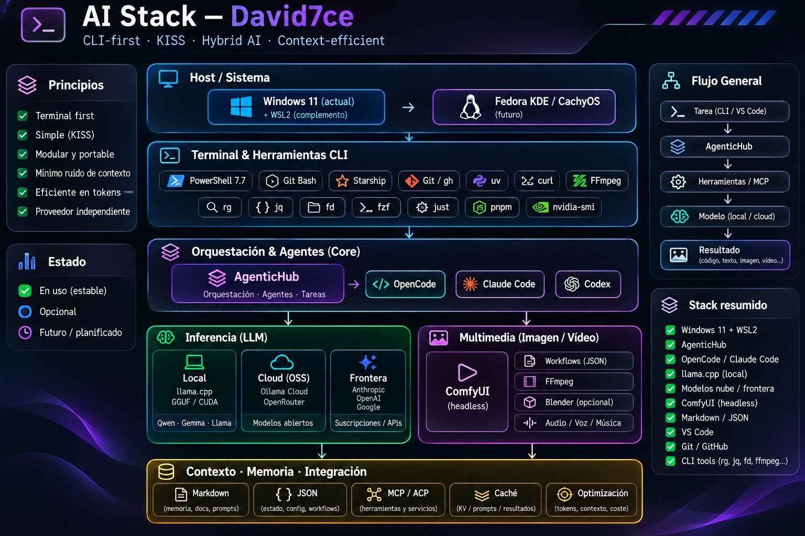

# Workspace panel

Inventory of every git repository under the workspace root (`D:\Workspaces` by
default), plus the owner's working notes. Part of the public AgenticHub repo;
the notes in `working/` are a separate nested repo with a private remote, ignored
here, and the per-machine config in `local/` is ignored too.

## AI stack



The stack is CLI-first and provider-independent: Windows 11 with WSL2 now and
Fedora KDE/CachyOS as the future host; PowerShell 7, Git Bash, Starship and the
usual terminal tools; AgentHub as the orchestration core around OpenCode, Claude
Code and Codex; local (llama.cpp/Ollama), open cloud and frontier inference;
ComfyUI for images, video and audio; and Markdown, JSON, MCP/ACP, cache and token
optimisation as the shared context. The diagram is the source of the summary:
update it when the stack changes.

## Install and use AgentHub

AgentHub is the local orchestration layer in [`../agent-hub/`](../agent-hub/).
It needs Node.js 22+, Git and whichever agent executables you will call (Claude
Code, OpenCode, Codex). Their sign-in is yours; the hub stores no credentials.

From the AgenticHub root:

```powershell
node agent-hub/hub.mjs init --dry-run
node agent-hub/hub.mjs init
# Edit agent-hub/consent.json and agent-hub/acp/agents.json:
# enable and acknowledge only the agents you will call, with expiry and limits.
node agent-hub/hub.mjs doctor
node agent-hub/hub.mjs ask opencode "Reply with exactly: HUB_OK" --permission deny --json
```

The last command makes a real model call and spends that provider's allowance.
The control-room summary and live state:

```powershell
node agent-hub/hubctl/hubctl.mjs brief
node agent-hub/hubctl/hubctl.mjs status
```

Optional, from `agent-hub/`: `npm link` installs the short `hub` command
(`hub doctor`); `node hub.mjs init --workspace` generates the chat-client
launchers beside the clone after a `--dry-run` review.

Authoritative setup guide: [agent-hub/docs/getting-started.md](../agent-hub/docs/getting-started.md).
Project overview: [agent-hub/README.md](../agent-hub/README.md).
Operating contract and safety rules: [agent-hub/AGENTS.md](../agent-hub/AGENTS.md)
and [agent-hub/docs/reference/agent-contract.md](../agent-hub/docs/reference/agent-contract.md).

## Folders

| Folder     | What it is                                                                  |
|------------|-----------------------------------------------------------------------------|
| `assets/`  | Diagrams used by this README; currently the AI stack overview.              |
| `index.html` | **Inicio**, generated by `build` (git-ignored like `dist/`): the glance page — repos, AI usage (weekly per subscription: work tokens, the plan's weekly percentage and a seven-day line) and roadmap numbers — with the same header as the other pages. |
| `tool/`    | The Node CLI that scans repos and builds the page. No dependencies.         |
| `dist/`    | Generated by `build`, ignored by git: the three pages, `repos.json` and `shared/`; `build` also writes the root `index.html` (Inicio). |
| `local/`   | Per-machine config, ignored by git. See [local/README.md](local/README.md). |
| `working/` | Private, nested repo (ignored here): roadmap, handoff, journal and AI costs. |
| `logs/`    | The agent hub's audit log and run evidence. Local only.                     |

## Commands

Node 22+, from any shell (PowerShell, Git Bash, WSL):

    node workspace-panel/tool/cli.mjs refresh           # costs --write + build: every page at once
    node workspace-panel/tool/cli.mjs build             # scan + rewrite dist/ (~9 s)
    node workspace-panel/tool/cli.mjs build --root DIR --depth 6 --jobs 8
    node workspace-panel/tool/cli.mjs sync [NAME...]    # fetch + fast-forward clean repos
    node workspace-panel/tool/cli.mjs sync --dry-run    # what would happen
    node workspace-panel/tool/cli.mjs sync --fetch      # fetch only
    node workspace-panel/tool/cli.mjs stars [--refresh] # GitHub stars -> local/stars.json, then build
    node workspace-panel/tool/cli.mjs costs             # scan local token histories (dry-run)
    node workspace-panel/tool/cli.mjs costs --write     # reconcile working/costs.json + COSTS.md, and read limits
    node --test "workspace-panel/tool/test/*.test.mjs"

`refresh` is the one to run (or to ask an agent for) when you want the panel up to
date. An optional hourly task runs it too: see [tool/schedule/](tool/schedule/README.md).
Inicio, [index.html](index.html), opens the panel and the notes straight from
disk (`file:///D:/Workspaces/AgenticHub/workspace-panel/index.html`).

`build` is offline and read-only. `sync` never merges, resets or forces: a repo
with uncommitted work, unpushed commits, no remote or no upstream is reported
and skipped (dirty/ahead are re-read live). For `stars`,
`GITHUB_TOKEN` raises GitHub's limit from 60 to 5,000 requests an hour.
`costs` reads local token metadata only, stores no prompts or
responses, and is a dry-run unless `--write` is explicit. The personal ledger
lives in `working/`; see [working/COSTS.md](working/COSTS.md) for coverage and
known gaps. It preserves prior buckets if a provider rotates or purges history.
With `--write`, it also stores a **limits reading** (`ledger.limits`):
- Codex detects the plan and reads the available account windows through `hubctl usage --json`.
- OpenCode Go accepts manually copied shared 5 h, weekly and monthly readings from
  the signed-in Console; the panel doesn't access the account or use API keys.
  The public model catalog is used independently
  to show USD allowances and input-only/output-only token equivalents at base rates.
  Go models show reference allowances on their toggles and estimated USD at base
  token rates in the chart tooltip (lowest listed cache-write tariff when TTL is unknown).
  These are not the subscription price or independent budgets per model.
- Claude Code can supply measured 5 h / weekly limits through its status line
  (see [local setup](local/README.md#subscription-limits)). No subscription
  monthly limit is assumed for Claude or Codex when the provider doesn't report one.
- Without a Claude measurement, rolling 5 h / 7 day work tokens and records are available locally.
- Claude's plan reference, empty until the first usage-limit hit in a transcript fills it,
  or until it is set in `local/limits.json` (git-ignored):

      {"claude": {"plan": "pro", "window5h": 1200000, "week": 9000000, "source": "manual"}}

"Work tokens" = input + output + cache writes (+ undisclosed totals); cache reads are
shown apart because they barely cost allowance.

## Output

The pages are one panel, **Workspaces Panel**, with the same header: the brand (icon + name) links
to Inicio (`workspace-panel/index.html`); the tabs are **Repositories** (`dist/index.html`), **AI Usage**
(`ai-usage.html`) and **Roadmap** (`notes.html`, which also holds Handoff and Journal), ES/EN
(Spanish by default) and light/dark. The choice is stored under `lang` / `theme`
and carries across tabs. Projects and AI Usage share the annual activity
heatmap (`tool/page/shared/calendar.js`), with day/week/month blocks. Choose a
calendar system (Gregorian, Islamic civil, Hebrew, Persian, Buddhist or Chinese)
and toggle **Monday first** (off = Sunday). The defaults are Gregorian and Monday.
The system determines actual year and month
boundaries; selecting a block still filters by its corresponding UTC dates.
Changing settings keeps the selected date as the anchor for the new block.
Use arrow keys to move through the grid, Enter or Space to select, and Escape
to clear. Preferences are remembered when browser storage is available.

The palette, the page frame, the header, the number format, the calendar and their
scripts are written **once** to `dist/shared/` (`tokens.css`, `base.css`,
`shell.css`, `calendar.css`, `shell.js`, `format.js`, `calendar.js`) and every page
links what it uses with a content hash (`?v=…`), so a rebuild is never served from
a stale cache. `base.css` owns the reset, `body`, `.wrap`, `.card`, `h2`, `.note`,
`.section-head`, `.empty` and `.table-wrap`, so a class means the same thing on all
three pages; the page sheets only add their own. The calendar goes only to the
pages that have `<!--CALENDAR-->`. Page-specific CSS and JS use the same hashed local links; only page data stays inline.
The page still opens straight from disk: `dist/` is self-contained as a folder, not
one file.

- `dist/index.html` (Repos) — a
  collapsible calendar of your commits (day/week/month) above one filterable,
  sortable repo table: a **Status** column with pending-work tags, VS Code links,
  a copyable `sync` command and **Commits** (the branch total; hover for how many
  are yours). Clicking a period on the calendar narrows the table to the repos you
  committed to then and turns Commits into your commits in that period. The
  branch shows next to the name only when it is not main/master. An AI card shows
  work tokens per agent (the same numbers as the IA tab) and links to it;
  `?year=2026&granularity=week` still works; `?calendar=islamic-civil&year=1448&granularity=month&weekStart=monday`
  opens the annual heatmap with those preferences.
- `dist/repos.json` — one object per repo. Other tools read it (the toolbox's
  git-meta-backup `scan.py --expected-json`), so its fields are a contract:

| Field                              | Meaning                                                                                                                                                     |
|------------------------------------|-------------------------------------------------------------------------------------------------------------------------------------------------------------|
| `owner`                            | Top-level folder (minus `-user`); clones in `Git-clones/` belong to `githubUser` from `local/config.json`.                                                  |
| `project`                          | Folder under the owner, an override, or for clones `Git Fork` (own commits) / `Git Clone` (none), unless the upstream account matches one of your projects. |
| `name`, `local`                    | Leaf folder name and absolute Windows path.                                                                                                                 |
| `remote`, `webUrl`, `remoteHost`   | `origin` with credentials stripped, its web page and forge label (SSH aliases resolved).                                                                    |
| `branch`                           | Current branch, or `(detached)`.                                                                                                                            |
| `dirty`                            | Real changes: CRLF-only and filemode-only differences are ignored.                                                                                          |
| `changes`                          | `dirty` by git's word, one per file: `modified`, `added`, `deleted`, `renamed`, `untracked`, `conflicted` (zero kinds omitted). Shown as coloured tags.        |
| `ahead`, `behind`, `hasUpstream`   | Against `@{u}` as of the last fetch (`sync` refreshes it).                                                                                                  |
| `stashes`, `otherBranches`         | Work `status` cannot see: stashes, and local branches with commits on no remote.                                                                            |
| `working`                          | Any of the above is non-zero (overridable with `working: false`).                                                                                           |
| `created`, `lastCommit`, `commits` | Root commit date, HEAD date, commits on the current branch.                                                                                                 |
| `stars`                            | From the `stars` cache, or `null`.                                                                                                                          |
- `dist/ai-usage.html` (IA) — offline page, same shared assets:
  - **Account limits**: one compact row per active subscription, week and month only.
    Missing or expired readings show `—`, not 0%; old readings are marked. A
    subscription is listed when the panel can detect its plan or when it has usage
    in the last seven days; the rest stay in **+ Add subscription**. Each one is a
    chip: click it to show or hide it (struck through when hidden) and use its caret
    menu for the plan and **Remove subscription**. **+ Add subscription** lists the
    missing ones grouped by provider, and **Auto** returns a plan to what the panel
    detects. OpenCode is one subscription whose menu includes **OpenCode Zen (free)**.
    Removing a provider hides it without deleting history. Models are not filtered
    here: **Who spends most** already ranks them.
    The visible page re-reads locally published figures once a minute: Claude from
    the status line and other providers when the regular refresh publishes new data.
    This does not query providers from the browser or start a service.
  - **Calendar** of work tokens (day/week/month). The selection drives everything below; no selection = all history.
  - Agent cards for the selection.
  - Codex account statistics, if supplied, are kept separate from local counters.
  - Daily bars split by the subscription that served the model, not the harness.
    OpenCode's response metadata supplies the provider and model where available;
    tokens no reply explains go to the session's model, or are split by each model's
    share, marked as provisional; retained aggregates of a single provider keep their
    labels, and mixed providers stay separate. OpenCode Zen (free or pay-as-you-go)
    has its own group, outside the Go allowance. Its single OpenAI OAuth connection can infer
    ChatGPT billing but does not prove which account historical requests used.
    Codex is read per call from its rollouts, each with its own hour and breakdown.
    A single selected day shows hourly bars for every source timed per step (Claude
    messages, Codex calls, OpenCode replies).
    Hover or focus a bar for model details; there are no duplicate chart tables.
  - **Who spends most**: subscriptions, projects and models ranked by work tokens,
    cache reads apart, plus a model recommendation based on the local benchmark.
  - The data time in the header, which turns amber after 6 h.
- `dist/notes.html` (Roadmap tab) — `working/ROADMAP.md` (editable in the browser, in Markdown), `HANDOFF.md` and `JOURNAL.md`
  rendered once per build with the panel's design, one section each (`#roadmap`,
  `#handoff`, `#journal`). The Markdown stays the source and JSON was considered and
  rejected: these are prose that an agent patches every session, and JSON would add
  escaping and lose line diffs for no consumer (the generated HTML is the view; the
  headings it exposes are already data). Links are rewritten: note-to-note links
  become anchors here, everything else becomes a `file://` URL to the real file, so
  a note opened at `file:///…/dist/notes.html` still reaches `AGENTS.md` and the
  repo docs. The page has one language (Spanish) and no selector; the renderer
  (`tool/page/md.mjs`) covers headings, lists, quotes, rules, bold, italics, inline
  code and links, and the tests fail if a note uses more than that.

## Code layout

    tool/cli.mjs          build | sync | stars | costs | refresh
    tool/lib/             git.mjs (runs git) · pool.mjs (bounded concurrency) · paths.mjs · costs.mjs (history/reconciliation/report) ·
                          usage-limits.mjs (account windows/quotas) · usage-records.mjs (record readers/tokens) ·
                          local.mjs (everything in local/) · remote.mjs · scan.mjs · sync.mjs · stars.mjs
    tool/page/render.mjs  writes repos.json + index.html + ai-usage.html + notes.html
                          and dist/shared/; delegates page assembly to renderDocument
    tool/page/md.mjs      the Markdown subset the notes use -> HTML (no deps)
    tool/page/notes.mjs   the notes page: reads working/*.md, rewrites their links
    tool/page/notes.*     template, styles and the sticky section links
    tool/page/shared.mjs  renderDocument: common titles, shell, data, content slots and hashed assets
    tool/page/shared/     tokens.css · base.css (reset, wrap, card, headings, note) ·
                          shell.{html,css,js} (header, tabs, lang/theme) ·
                          format.js (short tokens, grouped numbers) ·
                          calendar.{html,css,js} (year calendar fed a days map)
    tool/page/costs*      the IA page; usage-range.js aggregates a calendar selection
    tool/page/client/     index.html, styles.css, i18n.js, common.js (shared helpers),
                          repos.js, usage.js, main.js
    tool/schedule/        optional hourly Windows task running refresh
    tool/test/            node --test

All four pages use `renderDocument` in `shared.mjs`. Their templates share title,
data and shell placeholders; the page functions prepare their own data and content.
Page CSS and classic scripts are copied to `dist/shared/` and linked with a content
hash. Repositories keeps its script order in `CLIENT_SCRIPTS`; data loads first, then
shared helpers, then page scripts. The build validates page data and scripts together
before publishing. No module loader or server is required.

Project labels use friendly names for known folders (CLI App, Desktop App, Web App,
Obsidian PKM Vault, PKG Lab, Calendar XYZ, WikiTerra, CompuWiki and Workspaces Panel).
The account code-container prefix is omitted, while disk paths and per-repo
overrides remain unchanged. Website folders are shown as Website.
